# 部署與可搬移性

SaaS 與地端都預設部署在單節點 k3s，閘道器則維持用 systemd 執行。配合下面四條規則，日後不論是雲端與地端互搬、還是換雲端平台，都只需要改設定和 DNS。

系統架構：閘道器一律經 443 的 WebSocket 連線；SaaS 經 Cloudflare Tunnel，源站不開埠；地端由入口 gateway 直接在客戶網路對外。

```mermaid
flowchart TB
  subgraph ext["使用者與外部服務"]
    spa["瀏覽器 SPA<br>Vite + React，HTTPS 同網域"]
    idp["企業 IdP<br>OIDC：AD、Entra ID"]
    llm["LLM 端點<br>OpenAI 相容：聊天、向量、重排"]
    notify["通知<br>Email、Webhook；地端用客戶 SMTP"]
    sentry["Sentry<br>SaaS 送 sentry.io，地端預設關閉"]
  end
  subgraph k3s["k3s 叢集：SaaS 或客戶地端，同一份 Helm chart"]
    svc["Rust 微服務群<br>入口與服務間 mTLS：Istio ambient<br>跨服務寫入走事件"]
    broker["MQTT broker<br>Mosquitto，自建 CA mTLS"]
    subgraph data["資料儲存"]
      pg["Postgres + Apache AGE<br>各服務自有 schema、事件層、工作佇列<br>每租戶一個 graph"]
      ch["ClickHouse<br>時序窄表、每租戶 row policy<br>服務與閘道器日誌"]
      qd["Qdrant<br>文件頁面向量，依 tenant_id 分區<br>SaaS 用雲端版"]
      obj["物件儲存<br>PDF、頁面圖、聊天附件<br>SaaS 用 S3 或 R2"]
    end
    subgraph obs["觀測"]
      otel["OpenTelemetry collector<br>地端可轉送客戶 SIEM"]
      graf["Grafana<br>日誌與指標看板、維運告警"]
    end
  end
  subgraph field["現場（工廠）"]
    gw["閘道器 Rust agent<br>systemd、自建 OTA<br>TPM 金鑰 mTLS、離線緩衝"]
    dev["Modbus 設備<br>PLC、電表、變頻器"]
  end
  spa --> svc
  svc --> idp & llm & notify & sentry
  svc <--> broker
  svc --> data
  obs -->|"日誌寫入 ClickHouse，Grafana 查詢"| ch
  gw <-->|"443 WebSocket 內的 mTLS：資料與日誌上傳、設定下發"| broker
  gw -->|"Modbus 唯讀"| dev
```

上排是使用者與外部服務，中間是 k3s 內的九個元件：API 閘道與服務間 mTLS（Istio ambient）、Rust 微服務群、MQTT broker、四個資料儲存與兩個觀測元件（Postgres 內含 Apache AGE；SaaS 的 Qdrant 與物件儲存改用託管服務，地端全部在 k3s 內），下排是現場；SaaS 經 Cloudflare Tunnel 對外，源站不開任何埠；閘道器只主動連往雲端，資料與設定走一條 MQTT 連線（一律包在 WebSocket 內），憑證換發與 OTA 下載走 HTTPS。

- **k3s 的成本**：官方實測單一 server 約佔 1.2–1.6 GB RAM。我們的程式加上資料庫本來就因 ClickHouse 需要約 4 GB，原本規劃 8 GB；實測 k3s 約 0.95 GB、整套閒置約 2.7 GB，不跑地端 LLM 時暫定 8 GB，MS3 完成時以代表性負載重測峰值（[資源實測](https://docs.k3s.io/reference/resource-profiling)）。
- **閘道器不跑 k3s**：SD 卡與 eMMC 撐不住 k3s 的讀寫量（[硬體需求](https://docs.k3s.io/installation/requirements)）。
- **讓 k8s 只是打包工作的服務設計規則**：
  - 服務本身不存狀態。
  - 設定一律來自環境變數或設定檔。
  - 提供 health 與 readiness 端點。
  - 收到 SIGTERM 時能正常收尾：服務在容器內是 PID 1，不處理 SIGTERM 就會撐到寬限期結束被 SIGKILL；持有長連線的服務要主動關閉連線，讓用戶端立刻改連新的 pod。
  - DB migration 是獨立的 Job。
  - 排程工作用 Postgres advisory lock 互斥。互斥有時間界限：網路分割時兩個副本可能同時執行最多一個鎖逾時（預設 10 秒），所以工作必須冪等。
  - 資料接收用 MQTT shared subscription 分配。
  - 設定、health 與 readiness、SIGTERM 收尾與 advisory lock 由 `crates/service-kit` 實作，符合 [Helm chart 與服務的約定](../../deploy/chart/README.md)：服務自己的設定用 `TRUSTIOT__<SECTION>__<KEY>`，chart 的平台設定 `TRUSTIOT_<NAME>` 以 `platform` 表交給服務；kit 的收尾時間要在 chart 的 `drainSeconds` 內。細節見 [service-kit 的 README](../../crates/service-kit/README.md)。
- **完全斷網的地端環境**：以容器映像壓縮包加上部署描述安裝。

服務切分（決策 4）：服務隨里程碑逐步長出來，例如 MS1 需要憑證與佈建、資產、資料接收、閘道器營運與 MQTT 轉接五個（MQTT 轉接在 SaaS 與地端都部署）。上面的服務設計規則適用於每一個服務。

| 服務 | 目錄 | 負責 | 為什麼獨立 |
| --- | --- | --- | --- |
| 身分與租戶 | `services/identity` | 登入、成員、角色、租戶、配額上限、方案；替 API 閘道驗證 cookie 並簽發內部身分 | 權限只有一個來源 |
| 資產 | `services/assets` | 型號、設備、閘道器、綁定與解綁、閘道器數量配額 | 綁定時「閘道器數量不超過方案上限」要在同一筆交易內檢查 |
| 憑證與佈建 | `services/certs` | CA 簽章、出廠登錄、佈建、換發、撤銷 | 私鑰隔離，攻擊面最小 |
| 資料接收 | `services/ingest` | MQTT 到 ClickHouse、端到端確認 | 不能被其他服務拖垮 |
| 時序查詢 | `services/telemetry-query` | 讀 ClickHouse：設備圖表與即時圖表的歷史段（I3）、首頁卡片（L3）、健康歷史（H1）、AI 語意層工具（J3）；以每租戶唯讀帳號與查詢上限執行（決策 14） | 重查詢不能拖垮資料接收（I1） |
| 閘道器營運 | `services/gateway-ops` | 設定下發、在線狀態、即時圖表轉送、OTA 分批推送 | 負責跟閘道器的長連線與狀態 |
| MQTT 轉接 | `services/mqtt-bridge` | 把閘道器經入口 gateway 送來的 WebSocket 拆回 TCP 交給 broker，SaaS 前面多一段 Cloudflare Tunnel；來源 IP 依設定讀可信的標頭：SaaS 讀 CF-Connecting-IP，地端取入口 gateway 附加的 X-Forwarded-For 最右段（決策 6、27）；每 50 秒送 WebSocket ping，讀寫緩衝區 8 KiB，收到 SIGTERM 時送 WebSocket close | 只轉送加密的位元組，看不到 mTLS 內容 |
| AI 助理 | `services/assistant` | 對話、agent、工具 | 最吃記憶體，改動最頻繁 |
| AI 閘道 | `services/ai-gateway` | 供應商金鑰、轉發與串流、逾時與備援、模型角色、用量帳本、租戶 AI 額度（決策 28） | 額度要在一處原子檢查 |
| 警報與通知 | `services/alerts` | 規則、回測、通知中心、Email、Webhook | 背景排程，可以單獨擴充 |
| 現場脈絡 | `services/field-context` | 機台、機台關係、料號、生產區間、知識圖 | 見[現場脈絡與知識圖](field-context.md) |
| 知識庫 | `services/knowledge` | RAG、附件 | 前處理很吃資源，可以單獨排程 |

瀏覽器的流量只經過 API 閘道（決策 27）；現場閘道器的資料與設定只走 MQTT broker，不經過 API 閘道的 cookie 驗證；閘道器一律把 MQTT 包在 WebSocket 裡經 443 連線：SaaS 先連到 Cloudflare，再經 tunnel 與入口 gateway 交給 k3s 內的 MQTT 轉接服務（小型 Rust 服務，把 WebSocket 拆回 TCP 交給 broker）；地端連到客戶網路內的入口 gateway，同樣交給轉接服務，broker 不直接對外。mTLS 在 WebSocket 裡由閘道器直達 broker，Cloudflare、入口 gateway 與轉接服務只看得到加密的位元組，客戶端憑證、CRL 與 dynsec 照常運作。外層 TLS 在 SaaS 由 Cloudflare 終止，地端由入口 gateway 終止（用客戶的憑證或我們的 CA，閘道器的外層信任清單可設定），只負責穿過網路，安全只靠內層我們自己 CA 的 mTLS；工廠防火牆若會解開 443 的 TLS，只影響外層，可讓客戶把攔截用的 CA 加進外層的信任清單。轉接服務依設定讀入口傳來的可信標頭記錄閘道器的來源 IP，供稽核與限流：SaaS 只信 CF-Connecting-IP（用戶端自帶這個標頭時 Cloudflare 直接拒絕），地端只取入口 gateway 附加在 X-Forwarded-For 最右段的位址；用戶端自帶的 X-Forwarded-For 最左段與 True-Client-IP 會原樣傳進來，任何服務都不能拿來稽核或限流。Cloudflare 對兩個方向 125 秒都沒有資料的連線一律切斷：閘道器的 MQTT keepalive 設 60 秒，轉接服務另每 50 秒送 WebSocket ping；HTTP 串流要有不超過 60 秒的心跳，串流被截斷時狀態碼仍是 200，前端要靠心跳逾時察覺並續傳。閘道器程式只有 WebSocket 一種連線方式，SaaS 與地端相同。cloudflared 跑在主機上（systemd），由主機安裝程式（[deploy/host](../../deploy/host/README.md)，Laysi/trustiot-v2#64）從 Cloudflare 以釘選金鑰驗簽的官方套件庫安裝、以 OS 套件更新，token 存成只有 root 能讀的檔案，由 systemd 的 LoadCredential 交給服務；它是 SaaS 專屬的主機元件，不在 k8s 的部署描述內。cloudflared 以 systemd 沙箱設定執行：非 root 的動態使用者、檔案系統唯讀、禁止提權、拿掉所有 capability（`systemd-analyze security` 1.1）。同一個安裝程式設定 SaaS 主機的 firewalld 與 k3s：k3s 關閉 Traefik 與 ServiceLB（入口是 ClusterIP，主機上不需要也不允許任何 80、443 的監聽），firewalld 只信任 k3s 的 Pod 網段（Service 網段不會是封包來源，不信任）並拒絕 pod 連主機的 SSH，每個 zone 都不開 80、443。主機到入口 gateway 這一段不在 mesh 內，地位和入口前的負載平衡器相同，走 HTTP，入口把 x-forwarded-proto 改寫為 https；入口 gateway 由 NetworkPolicy 只放行本機來源，叢集內其他 pod 連不到，入口之後都在 mesh 內。維運 SSH 經同一條 tunnel，前面加 Cloudflare Access，只給維運人員；閘道器與產品流量不經 Access。憑證換發與 OTA 下載走 HTTPS；換發端點是入口 cookie 驗證的明列例外，改以 TPM 簽章驗證閘道器身分（決策 12）。

入口的路徑（2026-10-10 定案，Laysi/trustiot-v2#62）：入口有三個主機名稱，`hosts.app`（SPA 與 API）、`hosts.gateway`（閘道器）與 `hosts.ota`。不需要 cookie 的例外路徑只有四個，都是完整路徑比對，主機與服務固定：`hosts.app` 的 `/auth/login`（登入）與 `/healthz`（健康檢查）交給身分服務，`hosts.gateway` 的 `/certs/renew`（憑證換發）交給憑證服務、`/mqtt`（MQTT WebSocket）交給 MQTT 轉接服務；同一個路徑在別的主機照樣要 cookie。其他路徑都要 cookie，各服務以 chart 的 `ingress.routes` 加自己的路由；`/internal` 開頭的路徑一律拒絕，mesh 先解碼 `%2F` 並合併連續斜線再比對，所以 `//internal`、`/%2finternal` 也被拒絕（Laysi/trustiot-v2#255）。例外路徑的主機帶埠號（例如 `gw…:443`）也算例外。身分服務的 ext_authz 端點是 `/internal/ext-authz` 加上原始路徑，入口只把 cookie 交給它，逾時 0.5 秒；身分服務停機、出錯或逾時時入口回 503，session 無效時回身分服務的 401。細節與 chart 欄位見 [deploy/chart/README.md](../../deploy/chart/README.md) 的「入口 gateway」，Istio 的安裝與 provider 設定見 [deploy/istio/README.md](../../deploy/istio/README.md)。

平台元件與 chart 的分界（2026-10-12，Laysi/trustiot-v2#58，決策 5 的補充）：叢集層級的東西（Istio ambient、Gateway API CRD、CloudNativePG operator 與它的 CRD）是平台元件，每個叢集在裝 chart 之前各裝一次，版本固定在 `deploy/istio` 與 `deploy/cloudnative-pg`；chart 只產生 namespace 內的物件。Postgres（含 AGE）在兩種型態都是 chart 部署的 CloudNativePG Cluster（`postgres.mode: bundled`，清單 M8，之後的備份與副本由同一個 operator 加上），服務以 verify-full 連 `<cluster>-rw` 這個 Service、只信任 operator 產生的 CA；客戶自己維運 Postgres 時改成 `external`，只差在 values（可搬移規則 2）。細節見 chart README 的「叢集內的 Postgres」。

migration Job（2026-10-13，Laysi/trustiot-v2#60，決策 4、14、29，清單 M8）：每個服務的 Postgres migration、ClickHouse DDL 與資料庫角色只由一個 Job 處理，程式是 [tools/migrate](../../tools/migrate/README.md)，SaaS 與地端相同。

- **角色**：Job 以 migration 角色登入，bundled 是資料庫 owner `trustiot_owner`（bootstrap 時給它 CREATEROLE，沒有 SUPERUSER 與 BYPASSRLS），external 是客戶提供的同等角色。它為每個服務建立 `<服務>_owner`（不能登入，擁有 schema 與表，migration 以它執行）、`<服務>_app`（服務登入用，不擁有物件，沒有 BYPASSRLS），需要時再加 `<服務>_platform`；每租戶角色由註冊在 Job 裡的 hook 建立或補回。已存在的角色偏離這些規則時，Job 停止，不自動修改。
- **一次只跑一個**：整次執行持有一個 Postgres session 層級的 advisory lock，ClickHouse 的部分也在鎖內；第二個 Job 等第一個結束，然後發現沒有事要做。
- **冪等**：套用過的檔案記在 `trustiot_migrate.applied`（ClickHouse 有自己的一份），內容改了就停止；角色、schema、權限與密碼都先比對再改，設定沒變時再跑一次，資料庫什麼都不變。
- **服務在 Job 之後啟動**：Job 不是 Helm hook（叢集內的資料庫與 Job 由同一次安裝建立，pre-install hook 會早於資料庫，post-install hook 會與 `--wait` 互等）。Job 的名稱帶它 spec 的 hash，每個服務的 pod 有一個 init container 經 Kubernetes API 等這個 Job 完成，Job 換名時服務跟著滾動更新。細節、權限與失敗時的處理見 chart README 的「migration Job」與 [migration 的 runbook](../runbooks/migrations.md)。

可搬移的四條規則：

1. 閘道器連線的主機、OTA 下載網址一律用我們自己的網域，搬遷時只改 DNS。
2. 所有外部依賴（DB、向量庫、物件儲存、SMTP、LLM 與 embedding、rerank 端點、Sentry DSN、OTLP 轉送目的地）由設定指定；用託管服務或自建，只差在一份 Helm values。
3. ID 使用全域唯一格式（例如 UUIDv7），並提供以租戶為單位的匯出與匯入，地端與 SaaS 之間可以互搬。
4. 閘道器緩衝加上端到端確認，切換空窗期間不會丟資料。
