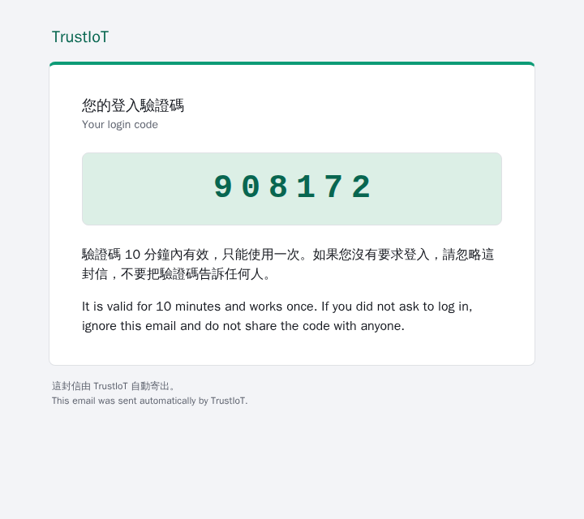
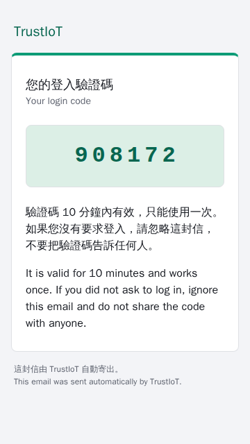
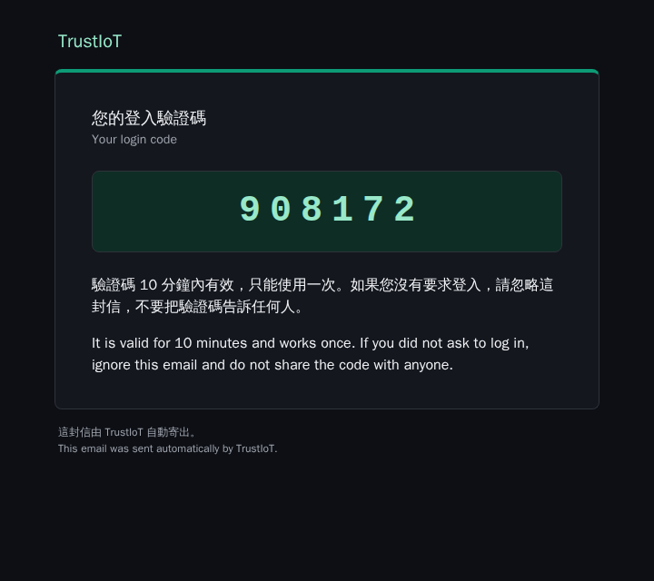
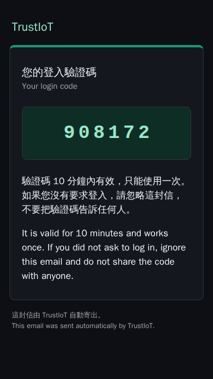

# 登入驗證碼 6 位數與 HTML 信件的渲染

對應 Laysi/trustiot-v2#1142：email 登入驗證碼改為 6 位數，信件改成 `multipart/alternative`（純文字加 HTML），HTML 的隱藏 preheader 與純文字的第一行都以驗證碼開頭。這份報告記錄 HTML part 在瀏覽器裡的渲染（淺色、深色，寬與窄的畫面），以及版型的自動檢查。

## 環境

- 建置主機（arm64 Linux），2026-11-07。
- 分支 `feat/1142-six-digit-html-login-mail`。
- 瀏覽器：釘選的 Playwright 映像 `mcr.microsoft.com/playwright:v1.64.1-noble@sha256:47b510dd9230bf0b9bfc9b20102241e577ea7a99334ab4c3ca19f19770e9b8ea`（`frontend/e2e/image.ts`），Chromium 156.0.8078.4。容器以 `--network none` 執行，所以頁面就算想載入外部資源也拿不到。
- 信件內容：`services/identity/src/login_email.rs` 以驗證碼 `908172`（測試用的固定值）產生的 HTML 與純文字，沒有收件地址（版型本來就不放地址）。

## 指令

在 repo 根目錄：

```sh
# 1. 由服務本身的程式產生範例信件（<dir>/sample.html 與 <dir>/sample.txt）
LOGIN_EMAIL_SAMPLE=<dir>/sample cargo test --locked -p identity --lib login_email::tests::write_a_sample_when_asked -- --exact

# 2. 把 frontend 鎖定版本的 playwright 套件與 render.mjs 複製到 <dir>，在釘選的 Playwright 映像裡開啟 HTML
bun install --cwd frontend --frozen-lockfile
mkdir -p <dir>/node_modules <dir>/out
cp -r frontend/node_modules/playwright frontend/node_modules/playwright-core <dir>/node_modules/
cp docs/test-reports/data/2026-11-07-1142-login-email/render.mjs <dir>/
echo '{"type":"module","private":true}' > <dir>/package.json
podman run --rm --network none --shm-size 1g --cap-drop ALL --security-opt no-new-privileges \
  -v <dir>:/work:Z -w /work "$(grep -oE 'mcr.microsoft.com/playwright:[^"]+' frontend/e2e/image.ts)" node render.mjs
```

[`render.mjs`](data/2026-11-07-1142-login-email/render.mjs) 以 `page.setContent` 開啟 `sample.html`，對 `light`／`dark` 兩種 `prefers-color-scheme` 與 720px、360px 兩種寬度各截一張全頁圖（`deviceScaleFactor` 1），並在頁面裡記錄：頁面發出的請求、驗證碼元素的文字與計算後的樣式、卡片寬度、preheader 的 `display` 與開頭文字、可見文字的開頭、有沒有水平捲動。

版型的自動檢查是 `cargo test -p identity --lib login_email`（見「結果」的第 2 點）。

## 結果

### 1. 渲染截圖

| | 寬（720px） | 窄（360px） |
| --- | --- | --- |
| 淺色 |  |  |
| 深色 |  |  |

頁面裡量到的值（完整紀錄在 [record.json](data/2026-11-07-1142-login-email/record.json)，純文字 part 在 [sample.txt](data/2026-11-07-1142-login-email/sample.txt)）：

| 項目 | 淺色 | 深色 |
| --- | --- | --- |
| 頁面發出的請求 | 0（四張都是） | 0（四張都是） |
| 驗證碼元素的文字 | `908172`（6 個數字，沒有插入其他字元） | `908172` |
| 驗證碼字級／字距（寬、窄） | 40px／10px、32px／6px，等寬字型 | 同左 |
| 驗證碼的顏色／底色 | `brand-strong` #086650 ／ `brand-soft` #dcefe6 | #98e8c9 ／ #0e2d25 |
| 卡片底色／頁面底色 | #ffffff ／ #f3f4f7 | #14171e ／ #0d0f15 |
| 卡片寬度（寬、窄） | 600px、328px（上限 600px，窄畫面兩側各留 16px） | 同左 |
| 水平捲動 | 無 | 無 |
| preheader | `display: none`，文字以 `908172 是您的 TrustIoT 登入驗證碼 · Your TrustIoT login code is 908172` 開頭，後面是不顯示的填充字元 | 同左 |
| 可見文字的開頭 | `TrustIoT`、`您的登入驗證碼`、`Your login code`、`908172`：preheader 不在可見文字裡 | 同左 |

純文字 part 的第一行是 `908172 是您的 TrustIoT 登入驗證碼 · Your TrustIoT login code is 908172`。

### 2. 版型的自動檢查（`services/identity/src/login_email.rs`、`src/mail.rs` 的單元測試）

- `both_bodies_hold_the_code_and_the_subject_does_not`：純文字與 HTML 都含驗證碼，大字的驗證碼是一段連續的 6 個數字；主旨不含任何數字；`Debug` 只印 `Message(<redacted>)`。
- `the_preview_starts_with_the_code`：`<body>` 之後的第一個元素是隱藏的 preheader（`display:none`、`max-height:0`、`opacity:0`、`overflow:hidden`、`mso-hide:all`），文字以驗證碼開頭，而且在版面的第一個表格之前；純文字的第一行以驗證碼開頭。
- `the_html_loads_nothing_and_links_nowhere`：HTML 裡沒有 `http`、`src=`、`<a `、`<script`、`url(`、`href`、`@import`、``、`"`、`'`）。
- `the_colours_meet_the_design_systems_contrast_rules`：版型用到的每一組前景與背景，在淺色與深色都符合設計系統的對比規則（文字至少 4.5:1，卡片上緣的品牌色條至少 3:1）。
- `the_html_uses_only_palette_colours_and_every_dark_colour_is_set`：HTML 只用 `PALETTE` 裡的顏色（取自 `docs/design/system/tokens.css`），每個顏色的淺色與深色值都用到了。
- `mail.rs` 的 `a_rendered_message_is_multipart_alternative_with_base64_parts` 與 `boundaries_are_random_and_cannot_occur_in_a_part`：信件是 `multipart/alternative`，先 `text/plain` 後 `text/html`，兩個 part 都是 base64（每行最多 76 字元），boundary 每封隨機、以 `=_` 開頭，所以不會出現在 base64 內容裡。

## 結論

| 驗收條件 | 結果 |
| --- | --- |
| 渲染證據：用瀏覽器開啟 HTML part，淺色、深色各截一張圖，連同實測紀錄存到 `docs/test-reports/` | 通過：上面四張截圖與 `record.json`。驗證碼在兩種主題都清楚，頁面沒有發出任何請求，窄畫面沒有水平捲動 |
| HTML 有隱藏的 preheader 並以驗證碼開頭；純文字第一行以驗證碼開頭 | 通過：單元測試，加上瀏覽器裡量到的 preheader（`display: none`、以驗證碼開頭、不在可見文字裡） |
| 真的信箱：收件匣列表裡這封信的摘要以驗證碼開頭 | 待測：需要部署了這個版本的環境與一個真的信箱，由維護者截圖（步驟寫在 PR 的「需要人工的步驟」） |

在 Gmail、Outlook、Apple Mail 與它們的深色模式逐一實測，是延後的進階驗證（issue 的「不包含」），不在這份報告裡。這裡的深色是 Chromium 依 `prefers-color-scheme: dark` 套用信件自己的深色樣式；不支援這個媒體查詢的客戶端顯示淺色版型，或依各自的規則反轉顏色。
